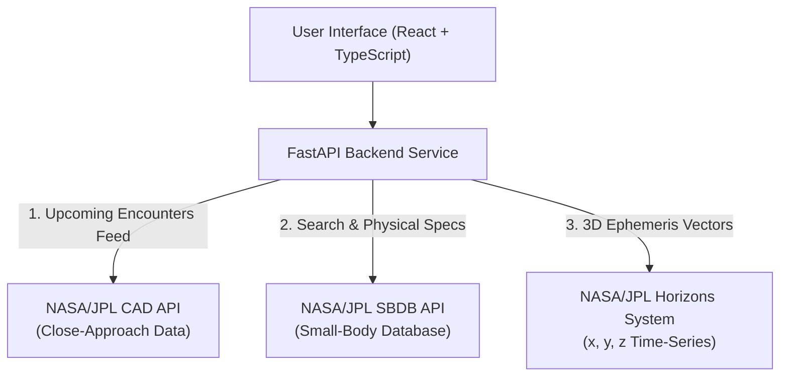

# OrbitWatch AI — Asteroid Tracking & Orbit Risk Explorer 🚀🌌

An interactive space science & orbital exploration application powered by real-time **NASA/JPL Small-Body services**. It translates celestial orbital mechanics, close approaches, and ephemeris vectors into clear 3D visualizations, data profiles, and plain-language scientific explanations.


---

## 🛰️ Integrated NASA/JPL Data Sources

OrbitWatch AI integrates three complementary NASA/JPL services:



1. **NASA/JPL Close-Approach Data (CAD) API** (`ssd-api.jpl.nasa.gov/cad.api`):
   - Feeds the live **Close-Approach Dashboard**.
   - Filters upcoming and historical flybys by date, Lunar Distance (LD), and Potentially Hazardous Asteroid (PHA) criteria.
2. **NASA/JPL Small-Body Database (SBDB) API** (`ssd-api.jpl.nasa.gov/sbdb.api`):
   - Powers the **Asteroid Search & Detailed Profile Modal**.
   - Retrieves Keplerian orbital elements ($a, e, i, \Omega, \omega, M$), 1-$\sigma$ uncertainties, observation arcs, condition code ($U$), and physical parameters (diameter, absolute magnitude $H$).
3. **NASA/JPL Horizons System API** (`ssd.jpl.nasa.gov/api/horizons.api`):
   - Powers the interactive **3D Orbit & Trajectory Simulator**.
   - Computes heliocentric vector positions $(x, y, z)$ in AU and orbital velocities $(v_x, v_y, v_z)$ across time steps, allowing interactive orbit playback alongside Earth.

---

## 🌟 Key Features

* **Live Close-Approach Feed:** View all near-Earth asteroids passing by our cosmic neighborhood with Lunar Distance meters and velocity readouts.
* **Keplerian Orbit Inspector:** Inspect orbital parameters ($a, e, i, \text{MOID}$) with formal uncertainties and observation provenance.
* **Interactive 3D Orbit Visualizer:**
  * Real-time 3D rotation, pitch/yaw tilting, and zoom.
  * Scrub timeline slider or hit **Play** to animate Earth and asteroid movement.
  * Real-time Earth-to-Asteroid distance calculation in both AU and Lunar Distances.
  * Toggle between 2D Ecliptic top-down view and 3D Perspective view to understand orbital inclination.
* **Bilingual Scientific Knowledge Base:** Plain-language explanations in **English** and **বাংলা** dispelling common alarmist myths (e.g., explaining why a close approach $\ne$ an impact).
* **Responsible Science & Data Provenance:** Strictly transparent scientific metrics without inventing unverified danger scores.

---

## 📂 Project Structure

```text
OrbitWatch/
├── backend/
│   ├── app/
│   │   ├── config.py              # App settings & NASA URLs
│   │   ├── main.py                # FastAPI application & CORS
│   │   ├── routes/                # Modular REST API endpoints
│   │   │   ├── health.py          # /api/v1/health
│   │   │   ├── objects.py         # /api/v1/objects (search & profile)
│   │   │   ├── close_approaches.py# /api/v1/close-approaches
│   │   │   ├── ephemeris.py       # /api/v1/ephemeris
│   │   │   └── glossary.py        # /api/v1/explain
│   │   ├── schemas/               # Pydantic data schemas
│   │   └── services/              # External NASA API clients & caching
│   ├── tests/                     # Pytest suite with unit & integration tests
│   └── requirements.txt
├── frontend/
│   ├── src/
│   │   ├── api/client.ts          # Axios API client
│   │   ├── components/            # React components (Dashboard, 3D Orbit, Modal, Glossary)
│   │   ├── types/                 # TypeScript interfaces
│   │   ├── App.tsx
│   │   └── main.tsx
│   ├── package.json
│   ├── tailwind.config.js
│   └── vite.config.ts
├── run_dev.ps1                    # One-click dev launcher (PowerShell)
├── run_dev.bat                    # One-click dev launcher (CMD)
└── README.md
```

---

## ⚡ Quick Start

### 1. Requirements
* Python 3.10+
* Node.js v18+ and npm

### 2. Automated Run
Double-click `run_dev.bat` or in PowerShell execute:
```powershell
.\run_dev.ps1
```

### 3. Manual Run

#### Backend (FastAPI):
```powershell
# Navigate and activate virtual environment
cd backend
.\.venv\Scripts\activate
# Start FastAPI server
$env:PYTHONPATH="."
uvicorn backend.app.main:app --reload --port 8000
```
* Backend API: `http://localhost:8000`
* Swagger Interactive Docs: `http://localhost:8000/docs`

#### Frontend (Vite + React):
```powershell
cd frontend
npm run dev
```
* Web Application: `http://localhost:5173`

---

## 🧪 Running Automated Tests

Run backend unit and integration test suite:
```powershell
$env:PYTHONPATH="."
backend\.venv\Scripts\pytest backend\tests\ -v
```

---

## 📜 Educational & Scientific Notice

OrbitWatch AI is an educational scientific explorer. It is **NOT** an official planetary defense service or impact warning system. Data is retrieved directly from NASA/JPL Small-Body services. For authoritative impact monitoring assessments, visit [NASA Center for Near-Earth Object Studies (CNEOS)](https://cneos.jpl.nasa.gov/).
