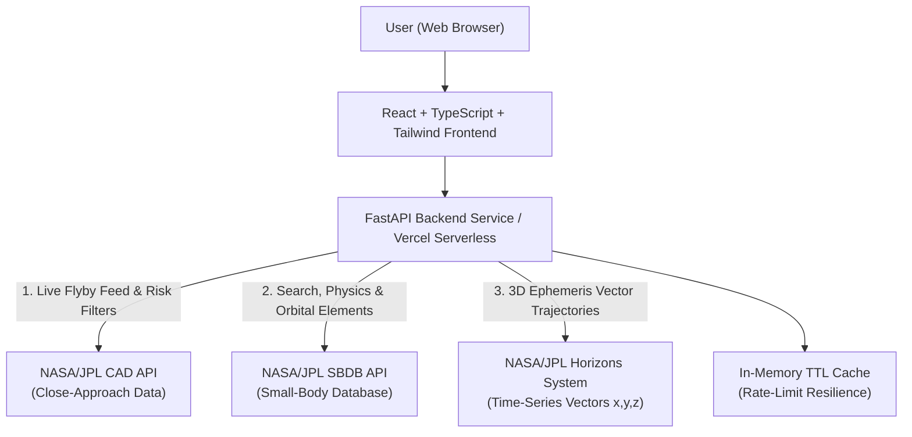

# 🌌 OrbitWatch AI — Asteroid Tracking & Orbit Risk Explorer 🚀

An interactive space science & orbital trajectory exploration web platform powered by real-time **NASA/JPL Small-Body services**. OrbitWatch AI translates complex celestial orbital mechanics, close approach tables, and time-series ephemeris vectors into vibrant 3D visualizations, data profiles, and plain-language scientific explanations.

[](https://vercel.com/)
[](https://opensource.org/licenses/MIT)
[](https://www.python.org/)
[](https://reactjs.org/)
[](https://vitejs.dev/)
[](https://fastapi.tiangolo.com/)
[](https://tailwindcss.com/)

---

## 🛰️ NASA / JPL Data Architecture

OrbitWatch AI integrates three complementary NASA/JPL services into a unified fullstack platform:



### Integrated NASA/JPL APIs:
1. **NASA/JPL Close-Approach Data (CAD) API** (`ssd-api.jpl.nasa.gov/cad.api`):
   - Feeds the **Near-Earth Asteroid Encounters Dashboard**.
   - Filters upcoming and historical flybys by date range, Lunar Distance (LD), and Potentially Hazardous Asteroid (PHA) criteria.
2. **NASA/JPL Small-Body Database (SBDB) API** (`ssd-api.jpl.nasa.gov/sbdb.api`):
   - Powers the **Asteroid Search & Detailed Profile Modal**.
   - Retrieves Keplerian orbital elements ($a, e, i, \Omega, \omega, M$), 1-$\sigma$ parameter uncertainties, observation arcs, condition code ($U$), and physical parameters (diameter, absolute magnitude $H$).
3. **NASA/JPL Horizons System API** (`ssd.jpl.nasa.gov/api/horizons.api`):
   - Powers the interactive **3D Orbit & Trajectory Simulator**.
   - Computes heliocentric vector positions $(x, y, z)$ in Astronomical Units (AU) and orbital velocities $(v_x, v_y, v_z)$ across time steps, enabling interactive orbital playback alongside Earth.

---

## 🌟 Key Features

* 🚀 **Vibrant Cosmic UI:** Designed with an immersive deep space theme featuring animated vector spacecraft, planetary rings, and glowing neon accents.
* 🧭 **Live Near-Earth Encounters Feed:** Discover approaching asteroids, monitor flyby dates (UTC), relative velocities (km/s), and miss distances in **Lunar Distances (1 LD ≈ 384,400 km)**.
* 🪐 **Interactive 3D Orbit Simulator:**
  * Real-time 3D camera controls: Pitch, Yaw, Pan, and Zoom.
  * Timeline scrubber and **Play/Pause animation** showing Earth and the asteroid moving along their real trajectories.
  * Real-time **Earth-to-Asteroid distance calculation** at any selected date.
  * Toggle between **Top-Down 2D (Ecliptic)** and **3D Perspective (Inclination)** views.
  * Quick-access presets for famous objects: *99942 Apophis, 101955 Bennu, 2024 YR4, 433 Eros, 162173 Ryugu*.
* 🔍 **Keplerian Parameter Inspector:** Comprehensive breakdown of orbital elements with formal 1-$\sigma$ uncertainties and observation arc provenance.
* 📖 **Bilingual Scientific Guide:** Clear definitions in English and বাংলা dispelling common alarmist myths (e.g., explaining why a close approach $\ne$ an impact).
* 🛡️ **Responsible Science:** Strictly transparent NASA metrics without generating unverified alarmist danger scores.

---

## ⚡ Deployment Guide (Vercel)

This repository is pre-configured for **One-Click Fullstack Deployment on Vercel** using `vercel.json` and Vercel's Python Serverless Runtime (`api/index.py`).

### Step-by-Step Vercel Deployment:

1. **Push your code to GitHub:**
   ```bash
   git add .
   git commit -m "feat: complete OrbitWatch AI application"
   git push -u origin main
   ```

2. **Deploy via Vercel Dashboard:**
   - Log into [Vercel](https://vercel.com/) with your GitHub account.
   - Click **"Add New..."** $\rightarrow$ **"Project"**.
   - Select the **`OrbitWatch`** repository from your GitHub list.
   - Leave the root directory as default (`./`).
   - Vercel will automatically detect `vercel.json`, build the React frontend via Vite, and deploy the FastAPI backend to Serverless Functions!
   - Click **Deploy**! 🚀

3. **Your Live Website:**
   - Within 1–2 minutes, your website will be live at `https://orbitwatch.vercel.app` (or your chosen Vercel domain)!

---

## 💻 Local Development Setup

### Prerequisites
* **Python 3.10+**
* **Node.js v18+** & npm
* **Git**

### Method 1: Instant Launcher (One-Click)
In PowerShell:
```powershell
.\run_dev.ps1
```
*(Or double-click `run_dev.bat` on Windows)*

### Method 2: Manual Terminal Execution

#### 1. Backend (FastAPI):
```powershell
# Navigate and setup environment
$env:PYTHONPATH="."
.\backend\.venv\Scripts\uvicorn backend.app.main:app --reload --port 8000
```
* Backend API: `http://localhost:8000`
* Swagger Interactive Docs: `http://localhost:8000/docs`

#### 2. Frontend (React + Vite):
```powershell
cd frontend
npm install
npm run dev
```
* Web Application: `http://localhost:5173`

---

## 📡 REST API Reference

| Method | Endpoint | Description |
| :--- | :--- | :--- |
| `GET` | `/api/v1/health` | Service health status and NASA API connectivity |
| `GET` | `/api/v1/close-approaches` | Query close approaches with date, distance (LD), and PHA filters |
| `GET` | `/api/v1/objects/search?q=...` | Search asteroids by name, designation, or SPK-ID |
| `GET` | `/api/v1/objects/{id}` | Get detailed object profile and Keplerian orbital elements |
| `GET` | `/api/v1/objects/{id}/close-approaches` | Get historical and upcoming flybys for a specific object |
| `GET` | `/api/v1/ephemeris/{id}` | Retrieve time-series $(x, y, z)$ Heliocentric ephemeris vectors |
| `GET` | `/api/v1/explain/glossary` | Educational glossary and scientific definitions |
| `GET` | `/api/v1/explain/disclaimer` | NASA CNEOS disclaimer notice |

---

## 🧪 Automated Testing

OrbitWatch includes an automated unit and integration test suite:

```powershell
$env:PYTHONPATH="."
backend\.venv\Scripts\pytest backend\tests\ -v
```

---

## 📜 Educational & Scientific Notice

> [!IMPORTANT]
> OrbitWatch AI is an educational scientific explorer. It is **NOT** an official planetary defense service or impact warning system. Data is retrieved directly from NASA/JPL Small-Body services. For official planetary defense assessments, visit the [NASA Center for Near-Earth Object Studies (CNEOS)](https://cneos.jpl.nasa.gov/).

---

## 👩‍💻 Author & Attribution

* **Repository:** [https://github.com/nazrana-nahreen/OrbitWatch](https://github.com/nazrana-nahreen/OrbitWatch)
* Data provided courtesy of **NASA / JPL-Caltech Solar System Dynamics (SSD)** and **CNEOS**.
